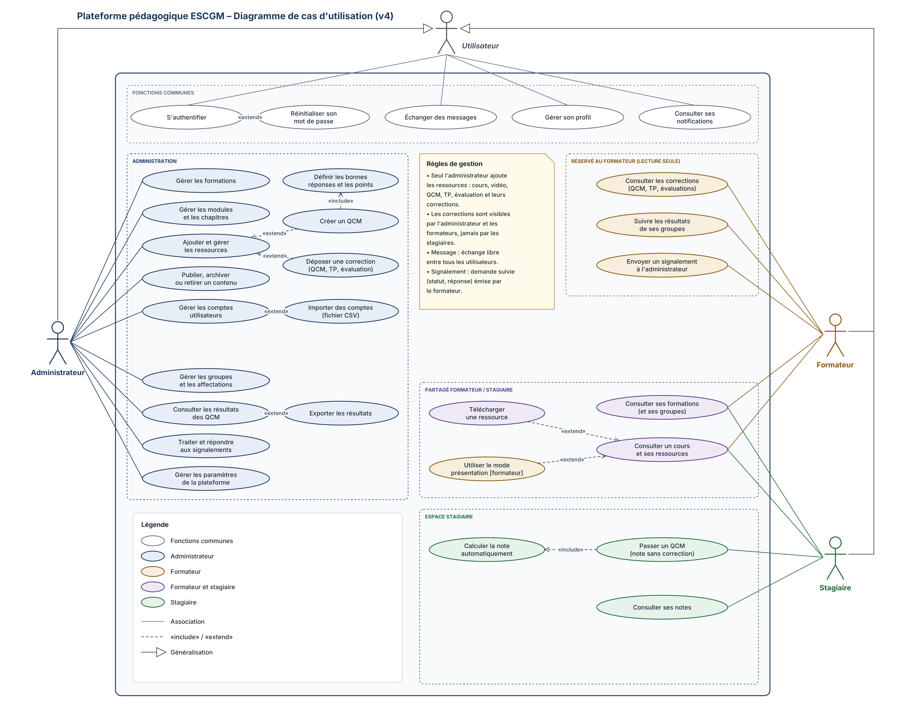
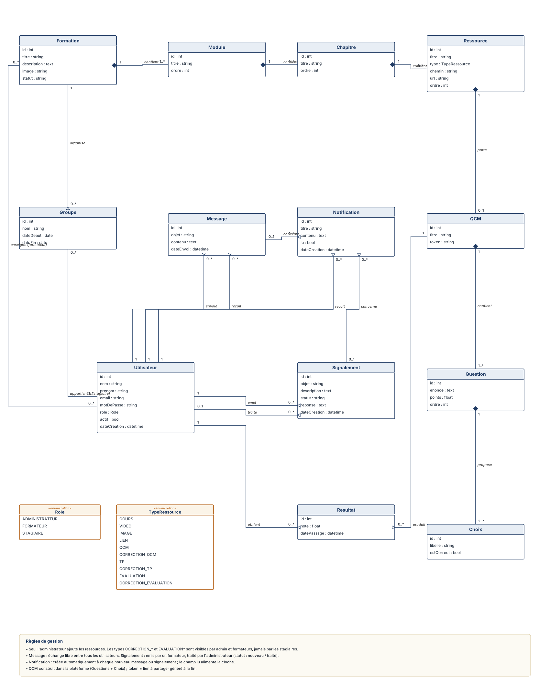

# Plateforme pédagogique ESCGM

Plateforme web de formation de l'**ESCGM** (École Supérieure de Commerce et de Gestion de Mayotte). Elle remplace l'espace pédagogique actuel, réalisé sous WordPress, par une application dédiée qui réunit les trois espaces de travail : **administration**, **formateur** et **stagiaire**.

Le site vitrine existant reste en place : un bouton « Espace pédagogique » sur sa page d'accueil renvoie vers la page de connexion de la plateforme. Chaque utilisateur est ensuite dirigé automatiquement vers l'espace correspondant à son rôle.

---

## Sommaire

1. [Fonctionnalités par espace](#fonctionnalités-par-espace)
2. [Règles de gestion](#règles-de-gestion)
3. [Conception](#conception)
4. [Technologies](#technologies)
5. [Architecture du projet](#architecture-du-projet)
6. [Fonctionnement](#fonctionnement)
7. [Installation en local](#installation-en-local)
8. [Organisation du travail (Git)](#organisation-du-travail-git)
9. [Équipe](#équipe)

---

## Fonctionnalités par espace

### Fonctions communes (tous les utilisateurs)
- S'authentifier, réinitialiser son mot de passe
- Gérer son profil
- Échanger des messages avec les autres utilisateurs
- Consulter ses notifications

### Espace administrateur
- Gérer les formations, les modules et les chapitres
- Ajouter et gérer les ressources : cours, vidéos, documents, TP, évaluations et leurs corrections
- Créer des QCM (questions, choix, bonnes réponses, points, seuil de réussite)
- Publier, archiver ou retirer un contenu
- Gérer les comptes utilisateurs (avec import CSV) et les groupes
- Consulter et exporter les résultats des QCM
- Traiter et répondre aux signalements des formateurs
- Gérer les paramètres de la plateforme

### Espace formateur
- Consulter la formation et le groupe qui lui sont affectés
- Consulter les cours et leurs ressources, télécharger une ressource
- Utiliser le mode présentation pendant une séance
- Consulter les corrections (QCM, TP, évaluations)
- **Publier la correction d'un TP pour son groupe**
- Suivre la progression et les résultats de ses stagiaires
- Échanger des messages avec ses stagiaires
- Envoyer un signalement à l'administrateur

### Espace stagiaire
- Consulter ses formations, les cours et leurs ressources
- Télécharger une ressource et les sujets de TP (le TP est rendu au formateur **en dehors de la plateforme**)
- Passer un QCM : note calculée automatiquement et correction affichée dès l'envoi des réponses
- Consulter la correction d'un TP **une fois publiée par son formateur**
- Consulter ses notes et sa progression
- Échanger des messages avec ses formateurs

---

## Règles de gestion

### Contenu
- **Seul l'administrateur ajoute du contenu** (cours, vidéos, documents, QCM, TP, évaluations et leurs corrections).
- Les stagiaires ne voient que le contenu **publié** de la formation de **leur groupe**.
- Un stagiaire appartient à **un seul groupe** ; un groupe suit **une formation**.
- Un formateur est affecté à **un seul groupe**.

### Corrections

| Correction | Administrateur | Formateur | Stagiaire |
|---|---|---|---|
| QCM | ✅ | ✅ | ✅ **immédiatement après avoir envoyé ses réponses** |
| TP | ✅ | ✅ | ✅ **seulement si son formateur l'a publiée pour son groupe** |
| Évaluation | ✅ | ✅ | ❌ jamais |

Ces règles sont appliquées **côté API**, pas uniquement dans l'interface : une correction non publiée n'est jamais envoyée au navigateur d'un stagiaire.

### QCM et progression
- Le QCM est construit dans la plateforme (questions + choix) ; la note est calculée automatiquement.
- L'administrateur fixe le **seuil de réussite** et le **nombre de tentatives** ; on conserve la **meilleure note**.
- Un chapitre est **terminé** quand son QCM est réussi (note ≥ seuil). Un chapitre sans QCM est terminé dès qu'il a été consulté.

### TP
- Le stagiaire télécharge le sujet, réalise le TP et le rend à son formateur **en dehors de la plateforme**. Il n'y a pas de dépôt de fichiers par les stagiaires.

### Messages, notifications et signalements
- **Messages** : un stagiaire écrit à ses formateurs et à l'administrateur ; formateurs et administrateur peuvent écrire à tout le monde. Pas de messagerie entre stagiaires.
- **Notification** : créée automatiquement à chaque nouveau message (ou réponse) et à chaque signalement ; elle apparaît sur la cloche jusqu'à ce qu'elle soit lue.
- **Signalement** : émis par un formateur, traité par l'administrateur (statut : `nouveau` / `traité`, avec une réponse).

---

## Conception

> **Évolutions décidées après la version 4 des diagrammes** (à intégrer dans leur prochaine version) :
> - la correction d'un QCM est visible par le stagiaire dès qu'il a envoyé ses réponses ;
> - la correction d'un TP devient visible aux stagiaires lorsque leur formateur la publie ;
> - nouvelle association **Formateur ↔ Groupe** (« enseigne ») : un formateur encadre un groupe ;
> - nouvelle classe **PublicationCorrection** (correction publiée pour un groupe, par un formateur, à une date).

### Diagramme de cas d'utilisation



### Diagramme de classes



**Hiérarchie du contenu pédagogique :**

```
Formation ─┬─ Module ─── Chapitre ─── Ressource ─── QCM ─── Question ─── Choix
           └─ Groupe ─── Utilisateur (stagiaire)
```

---

## Technologies

| Couche | Technologie | Rôle |
|---|---|---|
| Backend | **Laravel 12** (PHP 8.2+) | API REST |
| Authentification | **Laravel Sanctum** | Jetons d'accès (Bearer token) |
| Base de données | **MySQL / MariaDB** (XAMPP en local) | Stockage des données |
| Frontend | **React 19** + **Vite** | Interface utilisateur (SPA) |
| Navigation | **React Router 7** | Routes et espaces par rôle |
| Appels API | **Axios** | Communication avec le backend |
| Gestion de version | **Git / GitHub** | Travail collaboratif |

---

## Architecture du projet

Le backend et le frontend sont deux applications séparées qui communiquent en JSON.

```
plateforme_escgm/
├── docs/
│   └── diagrammes/              # Diagrammes UML
├── plateforme_backend/          # API Laravel
│   ├── app/
│   │   ├── Http/
│   │   │   ├── Controllers/
│   │   │   │   ├── Admin/       # Contrôleurs de l'espace administrateur
│   │   │   │   ├── Formateur/   # Contrôleurs de l'espace formateur
│   │   │   │   ├── Stagiaire/   # Contrôleurs de l'espace stagiaire
│   │   │   │   └── AuthController.php
│   │   │   └── Middleware/
│   │   │       └── CheckRole.php  # Contrôle d'accès par rôle
│   │   └── Models/              # Modèles Eloquent (Formation, Module, ...)
│   ├── database/
│   │   ├── migrations/          # Structure de la base
│   │   └── seeders/             # Données de test
│   └── routes/api.php           # Points d'entrée de l'API
└── plateforme_frontend/         # Application React
    └── src/
        ├── api/axios.js         # Instance Axios (URL de l'API + jeton)
        ├── auth/                # Contexte d'authentification, protection des routes
        ├── components/          # Composants réutilisables (Modal, Badge, ...)
        ├── layouts/             # Mise en page de chaque espace
        ├── pages/
        │   ├── auth/            # Connexion
        │   ├── admin/           # Pages de l'espace administrateur
        │   ├── formateur/       # Pages de l'espace formateur
        │   └── stagiaire/       # Pages de l'espace stagiaire
        └── theme.js             # Couleurs et styles partagés
```

---

## Fonctionnement

1. L'utilisateur clique sur le bouton « Espace pédagogique » du site ESCGM et arrive sur la page de connexion.
2. Le frontend envoie l'email et le mot de passe à `POST /api/login`.
3. L'API vérifie les identifiants et renvoie un **jeton Sanctum** avec les informations de l'utilisateur, dont son **rôle** (`admin`, `formateur` ou `stagiaire`).
4. Le frontend enregistre le jeton et redirige l'utilisateur vers son espace (`/admin`, `/formateur` ou `/stagiaire`).
5. Chaque requête suivante envoie le jeton dans l'en-tête `Authorization: Bearer <jeton>`.
6. Côté API, le middleware `role:` vérifie que l'utilisateur a le droit d'accéder à la route demandée (sinon : erreur 403).

**Préfixes des routes de l'API :**

| Préfixe | Accès |
|---|---|
| `/api/login`, `/api/logout`, `/api/me` | Authentification |
| `/api/admin/...` | Administrateur |
| `/api/formateur/...` | Formateur |
| `/api/stagiaire/...` | Stagiaire |

---

## Installation en local

### Prérequis
- **XAMPP** (PHP 8.2+ et MySQL/MariaDB)
- **Composer**
- **Node.js** 20 ou plus récent
- **Git**

### 1. Cloner le dépôt
```bash
git clone https://github.com/douae200508/plateforme_escgm.git
cd plateforme_escgm
```

### 2. Backend (Laravel)
```bash
cd plateforme_backend
composer install
cp .env.example .env
php artisan key:generate
```

Dans le fichier `.env`, configurer la base de données :
```env
DB_CONNECTION=mysql
DB_HOST=127.0.0.1
DB_PORT=3306
DB_DATABASE=plateforme_escgm
DB_USERNAME=root
DB_PASSWORD=
```

Créer la base `plateforme_escgm` dans phpMyAdmin, puis :
```bash
php artisan migrate --seed     # crée les tables et les données de test
php artisan storage:link       # rend les fichiers déposés accessibles
php artisan serve              # API sur http://127.0.0.1:8000
```

### 3. Frontend (React)
Dans un second terminal :
```bash
cd plateforme_frontend
npm install
npm run dev                    # application sur http://localhost:5173
```

> Le fichier `.env` contient des informations propres à chaque poste : il n'est **jamais** envoyé sur GitHub.

---

## Organisation du travail (Git)

### Branches

```
salma  ─┐
        ├──►  develop  ──►  main
douae  ─┘
```

| Branche | Rôle |
|---|---|
| `main` | Version stable, validée et prête à être livrée |
| `develop` | Branche d'intégration : on y réunit et on y teste le travail de l'équipe |
| `douae` | Travail de Douae (espace administrateur) |
| `salma` | Travail de Salma (espaces formateur et stagiaire) |

### Règles

1. **On ne pousse jamais directement sur `main` ni sur `develop`.** Toute fusion passe par une **Pull Request**.
2. Chacune travaille sur sa branche et ouvre une Pull Request vers `develop` quand une fonctionnalité est terminée.
3. Avant d'ouvrir une Pull Request, on récupère les derniers changements de `develop` dans sa branche :
   ```bash
   git fetch origin
   git merge origin/develop
   ```
4. `develop` est fusionnée dans `main` à chaque étape stable (après test).
5. Les **fichiers partagés** (`routes/api.php`, `App.jsx`, migrations, modèles, `theme.js`, composants communs) : on prévient l'autre avant de les modifier.
6. Des messages de commit clairs, en français, qui décrivent ce qui a été fait.

### Répartition

| Espace | Responsable | Dossiers principaux |
|---|---|---|
| Administration | Douae | `Controllers/Admin`, `pages/admin` |
| Formateur et stagiaire | Salma | `Controllers/Formateur`, `Controllers/Stagiaire`, `pages/formateur`, `pages/stagiaire` |

---

## Équipe

- **Douae**, espace administrateur
- **Salma**, espaces formateur et stagiaire

Projet réalisé pour l'ESCGM, 2026.
